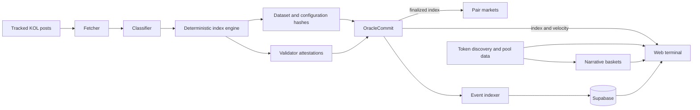

<div align="center">


# NARRATIVE INDEX

**Measure narrative attention. Explore the data. Put a view onchain.**

An onchain narrative intelligence platform for Robinhood Chain.

[App](https://narrativeindex.tech) · [Terminal](https://narrativeindex.tech/terminal) · [Radar](https://narrativeindex.tech/radar) · [Markets](https://narrativeindex.tech/markets) · [Baskets](https://narrativeindex.tech/baskets) · [Project report](docs/nti_report.md)

[](https://robinhoodchain.blockscout.com/)
[](apps/web)
[](contracts/src)
[](services)

</div>

---

## ⚡ Overview

**Narrative Index (NTI)** turns discussion by a tracked set of accounts into a measurable view of ten crypto narratives. A data pipeline collects posts, classifies their relevance, computes a deterministic index, and submits signed results to an onchain oracle. The app presents the index alongside discovery, pair markets and token baskets.

The tracked narratives are Privacy / ZK, AI Agents, RWA, Stablecoins, DePIN, Prediction Markets, Perp DEX, DeFi, Memecoin and Gaming. An index measures relative attention in the tracked dataset; it is **not** the price of a token, a measure of the entire internet or a guarantee of future performance.

The protocol is deployed on **Robinhood Chain mainnet (chain ID 4663)**. The current protocol token is **pNTI**, a prelaunch token used by the existing staking and market mechanisms; it is not a claim that the final NTI token has launched. See [mainnet operations](MAINNET.md) and the [project report](docs/nti_report.md).

## 🔬 How the system works



1. **Collect and classify.** The fetcher gathers posts from tracked accounts. The classifier assigns narrative relevance; discovery separately follows tokens and liquidity.
2. **Calculate.** The engine applies the versioned configuration in [`config/nti.v1.json`](config/nti.v1.json), including a four-hour epoch, a seven-day lookback and KOL concentration controls.
3. **Commit and finalize.** The operator submits the dataset and configuration commitments with validator attestations. The oracle tracks committed, disputed, final and incomplete epochs. Only final results are presented as finalized data.
4. **Explore and participate.** The terminal and narrative pages display the index and its history. Radar surfaces discovery signals; markets compare narratives; baskets hold a configured set of tokens.

### Index, velocity and gaps

The index is a narrative's share of measured attention. Velocity is a change relative to an earlier index, subject to the configured lag and data-quality rules. A finalized epoch can still lack a usable velocity if its required comparison is missing or does not meet those rules. An incomplete epoch does not erase a previous finalized value; it also must not be treated as a finalized result or silently filled in.

### Pair markets and baskets

Pair markets are parimutuel markets anchored to a finalized base epoch. The configured horizons are 6 or 42 four-hour epochs. On settlement the contract compares **relative index growth** of the two sides between the base and settlement epochs; it does not simply choose the largest current index or use the displayed 24-hour velocity. Ties, incomplete results and other contract-defined conditions can lead to refunds. Read [`NarrativeMarket.sol`](contracts/src/NarrativeMarket.sol) for the exact rules.

A basket is a vault associated with a narrative and backed by approved token holdings. Deposits and redemptions use supported Uniswap V3 pools against WETH; the current contracts check liquidity and a 30-minute TWAP. Holdings and weights are configured and maintained separately from KOL mention counts. A token appearing in KOL discussion does not automatically enter a basket. Pool depth, slippage and token eligibility matter.

## 🖥️ Platform

| Page | What it does |
|---|---|
| [Terminal](https://narrativeindex.tech/terminal) | Overview of narrative index data and recent activity |
| [Narratives](https://narrativeindex.tech/narratives/2) | Per-narrative history, contributors and related mentions |
| [Heatmap](https://narrativeindex.tech/heatmap) | Explore narratives and discovered tokens |
| [Radar](https://narrativeindex.tech/radar) | Velocity and onchain token discovery signals |
| [Pair markets](https://narrativeindex.tech/markets) | Create, explore and settle relative narrative markets |
| [Baskets](https://narrativeindex.tech/baskets) | View narrative vaults, constituents and deposit / redemption flows |
| [Portfolio](https://narrativeindex.tech/portfolio) | View a connected wallet's positions |
| [Oracle](https://narrativeindex.tech/oracle) | Inspect epochs, commitments and finalization |
| [Staking](https://narrativeindex.tech/stake) · [Grants](https://narrativeindex.tech/grants) | Staking and grants interfaces |
| [Methodology](https://narrativeindex.tech/methodology) | Definitions, calculation and protocol context |

Availability and values depend on the deployed contracts, data freshness, wallet connection and liquidity. A visible interface alone is not evidence that every financial transaction has been tested end to end.

## 📁 Repository structure

```text
NTI/
├── apps/web/              Next.js app, API routes and wallet interfaces
├── packages/sdk/          Shared narratives, addresses and contract ABIs
├── contracts/             Solidity contracts, deployment manifests and Foundry tests
├── services/
│   ├── fetcher/           X collection and fetch evidence
│   ├── classifier/        Narrative classification
│   ├── engine/            Deterministic index calculations
│   ├── oracle_node/       Operator, validators, keeper and monitoring
│   ├── discovery/         Token and KOL discovery
│   └── nti_core/          Shared configuration and types
├── indexer/               Chain event indexer and Supabase mirror
├── supabase/migrations/   Database schema and policies
├── config/                Versioned configuration and token lists
├── infra/                 Operational scripts and PM2 configuration
└── docs/                  Project report and operational documentation
```

## 🛠️ Stack

| Layer | Technology |
|---|---|
| Frontend | Next.js 15, React 19, TypeScript, Tailwind, wagmi and viem |
| Contracts | Solidity 0.8.26, OpenZeppelin upgradeable contracts, Foundry |
| Offchain services | Python, uv workspace, deterministic Decimal-based engine |
| Data | Supabase Postgres and Storage, TypeScript chain indexer |
| Operations | PM2 and VPS services; Vercel web deployment |
| Network | Robinhood Chain mainnet 4663; testnet 46630 |

## 🚀 Local development

Prerequisites: Node.js 22+, pnpm 9, Python 3.11+, [uv](https://docs.astral.sh/uv/) and Foundry. A live-data environment also needs the appropriate RPC, database and service credentials. Use [`infra/.env.example`](infra/.env.example) as a reference; never commit secrets.

```bash
pnpm install
pnpm build:sdk
uv sync --directory services --all-packages
pnpm dev:web
```

The local web app uses `apps/web/.env.local` for its environment. Production services have additional configuration and credentials; consult the runbooks instead of pointing local jobs at production by accident.

## 🧪 Tests and checks

```bash
# Contracts
forge test --root contracts

# Python services
uv run --directory services ruff check .
uv run --directory services pytest

# TypeScript, indexer and web
pnpm typecheck
pnpm --filter @nti/indexer test
pnpm build:web
node --test apps/web/tests/*.test.mjs
```

The commands above are the project's verification entry points, not a claim that every suite or a funded mainnet lifecycle was rerun for this documentation. For current observations and their limits, see the [report](docs/nti_report.md).

## 🌐 Mainnet contracts

Deployment manifest: [`contracts/deployments/4663.json`](contracts/deployments/4663.json). The table lists proxy or deployed contract addresses from that manifest; consult the chain for current implementations and configuration.

| Contract | Address |
|---|---|
| OracleCommit | [`0xb04747563eA9A2d8dDde0a62b4ea9A77Ef9CEc70`](https://robinhoodchain.blockscout.com/address/0xb04747563eA9A2d8dDde0a62b4ea9A77Ef9CEc70) |
| NTIRegistry | [`0xbda7ecB8a9Ed996313E8F9639176Ed475CE01d2C`](https://robinhoodchain.blockscout.com/address/0xbda7ecB8a9Ed996313E8F9639176Ed475CE01d2C) |
| NarrativeMarket | [`0xE708248154cF942FF2d7084d7E12383dc242043C`](https://robinhoodchain.blockscout.com/address/0xE708248154cF942FF2d7084d7E12383dc242043C) |
| BasketFactory | [`0x10BfA8C15F5E8fd9A84626a4c659C2533C784144`](https://robinhoodchain.blockscout.com/address/0x10BfA8C15F5E8fd9A84626a4c659C2533C784144) |
| Staking | [`0xA5d1e445D0dd2B5248AC1b93ADcd9466445B14e6`](https://robinhoodchain.blockscout.com/address/0xA5d1e445D0dd2B5248AC1b93ADcd9466445B14e6) |
| pNTI prelaunch token | [`0xA48B26C9Ca9E4C4300699138983B79cbd28bbCfa`](https://robinhoodchain.blockscout.com/address/0xA48B26C9Ca9E4C4300699138983B79cbd28bbCfa) |

## 🔐 Trust and limitations

- Index quality depends on the tracked accounts, data collection, classifier and versioned methodology; it is not a comprehensive measure of all discussion.
- Finalization depends on the operator, validators, onchain checks and dispute process. Epochs can be incomplete and velocity can be unavailable.
- Contracts use upgradeable and role-controlled components. The mainnet manifest lists no deployed governor or timelock; consult live onchain roles before relying on administrative assumptions.
- Basket eligibility is constrained by the supported pools, price history and liquidity. The existence of a token on Robinhood Chain does not mean it is eligible for a vault.
- Market and basket participation involves real assets, transaction costs and smart-contract, oracle and liquidity risk.

## 📚 Documentation

- [Project report and architecture](docs/nti_report.md)
- [Mainnet runbook](MAINNET.md) · [Mainnet decisions](docs/MAINNET_DECISIONS.md) · [Launch checklist](docs/MAINNET_LAUNCH_CHECKLIST.md)
- [Operations and recovery](docs/TESTNET_OPERATIONS.md) · [Source and classifier checks](docs/SOURCE_AND_CLASSIFIER_CHECKS.md)
- [Versioned index parameters](config/nti.v1.json) · [Contract deployment manifest](contracts/deployments/4663.json)

## 📄 License

See the license notices in the repository and individual source files. No repository-wide license was present in the GitHub metadata at the time this document was written.
