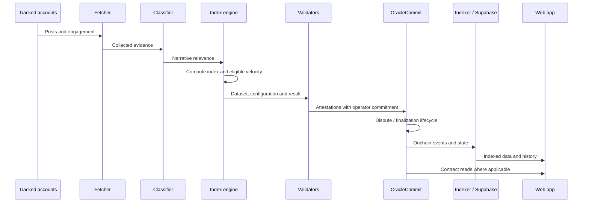

# Narrative Index: Project Report & Architecture Overview

**Project:** Narrative Index (NTI)  
**Application:** [narrativeindex.tech](https://narrativeindex.tech)  
**Network:** Robinhood Chain mainnet, chain ID `4663`  
**Repository:** [NTI-corp/NTI](https://github.com/NTI-corp/NTI)  
**Report snapshot:** 28 November 2026, Asia/Bangkok

This report describes the repository and a limited live read at the time of writing. Contract configuration, epoch status, liquidity and the set of active markets can change. A successful API read is not a funded end-to-end transaction test.

---

## 1. Project description

Narrative Index measures the relative attention paid to a fixed set of crypto narratives by a tracked cohort of accounts. It combines post collection, classification and a deterministic scoring engine with an onchain oracle. The web app exposes the result through a terminal, narrative pages, discovery tools, markets, baskets and portfolio views.

The configured narratives are **Privacy / ZK, AI Agents, RWA, Stablecoins, DePIN, Prediction Markets, Perp DEX, DeFi, Memecoin and Gaming**. Their IDs and definitions are in [`packages/sdk/src/narratives.ts`](../packages/sdk/src/narratives.ts).

The platform is deployed on Robinhood Chain mainnet. The configured pNTI token is a **prelaunch token**; the repository's mainnet runbook describes a later replacement procedure. pNTI should not be presented as proof that the final NTI token has launched.

---

## 2. Value proposition and boundaries

Crypto discussion moves quickly and raw mention counts can be dominated by the size and activity of individual accounts. NTI brings a repeatable workflow to that data: a defined cohort, stored fetch evidence, narrative relevance classifications, a versioned scoring configuration and signed oracle results. The product then lets users inspect the index or use separate onchain products built around it.

The index is **relative attention in the collected dataset**. It does not measure every participant, guarantee the factual accuracy of posts, certify the identity of a token mentioned by ticker, or predict returns. A narrative's index is distinct from an individual asset's price.

---

## 3. End-to-end flow

1. The fetcher gathers posts and engagement from the tracked account cohort and records fetch evidence.
2. The classifier produces narrative relevance values. The engine applies the versioned parameters to calculate index vectors; the configured epoch length is four hours.
3. The oracle operator submits commitments with validator attestations. The contracts retain epoch states and allow dispute and finalization under their configured timing and role rules.
4. The indexer mirrors events and the app combines indexed records with direct contract reads. The discovery service maintains token and KOL data separately.
5. Users can inspect the results, take a position in a pair market or interact with a configured basket, subject to each product's own contract rules.

### Finalization and velocity

`OracleCommit` distinguishes committed, disputed, final and incomplete epochs. A finalized index is not the same thing as a valid velocity value: velocity uses a lagged comparison and eligibility conditions. With a missing or incomplete comparison, the UI should retain a previous genuinely finalized velocity when appropriate and mark the gap rather than manufacture a new one. Parameters such as the six-epoch lag are versioned in [`config/nti.v1.json`](../config/nti.v1.json).

### Pair market lifecycle

The contract anchors a market to a finalized base epoch and accepts a configured settlement horizon. The current source defines short and long horizons of 6 and 42 epochs, corresponding to 24 hours and seven days at a four-hour cadence. Participants select a side and place ETH into a parimutuel pool during the permitted window. Once the settlement epoch is eligible, the contract compares each side's **relative change in finalized index** from base to settlement. It uses the final indices for both epochs; the 24-hour velocity shown in analytics is not the settlement input.

The contract contains refund paths for an incomplete or timed-out result and for other conditions such as a tie. Payouts, fees, caps, cutoff and eligibility are governed by the deployed contract. See [`NarrativeMarket.sol`](../contracts/src/NarrativeMarket.sol).

### Basket lifecycle

An authorized setup configures a basket for a narrative with approved constituent tokens and target weights. Deposits use ETH and execute swaps into constituents; redemption follows the contract's exit path. Current basket pricing and swaps rely on supported Uniswap V3 token/WETH pools and a 30-minute TWAP. Each token weight is capped at 40%, so a fully allocated basket needs at least three constituents. The keeper maintains existing approved constituents; it does not automatically select or weight tokens based on KOL mention counts. See [`Basket.sol`](../contracts/src/Basket.sol), [`BasketFactory.sol`](../contracts/src/BasketFactory.sol) and [`keeper_baskets.py`](../services/oracle_node/src/nti_oracle/keeper_baskets.py).

---

## 4. Architecture and components

| Component | Responsibility | Source |
|---|---|---|
| Fetcher | Collect X posts and engagement; persist fetch evidence | [`services/fetcher`](../services/fetcher) |
| Classifier | Assign narrative relevance to collected posts | [`services/classifier`](../services/classifier) |
| Index engine | Compute deterministic index results using versioned parameters | [`services/engine`](../services/engine) |
| Oracle node | Run operator, validator, keeper and monitoring roles | [`services/oracle_node`](../services/oracle_node) |
| Discovery | Track KOLs, tokens, liquidity and Radar candidates | [`services/discovery`](../services/discovery) |
| Chain contracts | Oracle, disputes, markets, baskets, staking, fee routing and grants | [`contracts/src`](../contracts/src) |
| Indexer | Mirror chain events to the database | [`indexer`](../indexer) |
| Web and SDK | User interface, API routes, shared ABI and address definitions | [`apps/web`](../apps/web), [`packages/sdk`](../packages/sdk) |

Oracle data, token discovery and basket composition are related but separate flows. A discovered token, a KOL ticker mention and a basket constituent are not automatically the same verified asset.

---

## 5. Technology stack

| Layer | Technology |
|---|---|
| Web | Next.js 15, React 19, TypeScript, Tailwind, wagmi, viem |
| Smart contracts | Solidity 0.8.26, OpenZeppelin, Foundry |
| Data services | Python 3.11+ workspace with uv; Decimal-based index engine |
| Indexer | TypeScript and viem |
| Database and artifacts | Supabase Postgres and Storage |
| Deployment | Vercel for web; PM2-managed services on a VPS |
| Chain | Robinhood Chain mainnet `4663`; testnet `46630` |

---

## 6. Mainnet deployment

The mainnet manifest records deployment at block **123091276**. Addresses below are from [`contracts/deployments/4663.json`](../contracts/deployments/4663.json); they identify deployed proxies or contracts, not a fresh verification of every current implementation or role.

| Component | Address |
|---|---|
| OracleCommit | [`0xb04747563eA9A2d8dDde0a62b4ea9A77Ef9CEc70`](https://robinhoodchain.blockscout.com/address/0xb04747563eA9A2d8dDde0a62b4ea9A77Ef9CEc70) |
| NTIRegistry | [`0xbda7ecB8a9Ed996313E8F9639176Ed475CE01d2C`](https://robinhoodchain.blockscout.com/address/0xbda7ecB8a9Ed996313E8F9639176Ed475CE01d2C) |
| ConfigRegistry | [`0x7C3d45b3a791B0E596b9254BC54b0e7098EDf77E`](https://robinhoodchain.blockscout.com/address/0x7C3d45b3a791B0E596b9254BC54b0e7098EDf77E) |
| NarrativeMarket | [`0xE708248154cF942FF2d7084d7E12383dc242043C`](https://robinhoodchain.blockscout.com/address/0xE708248154cF942FF2d7084d7E12383dc242043C) |
| BasketFactory | [`0x10BfA8C15F5E8fd9A84626a4c659C2533C784144`](https://robinhoodchain.blockscout.com/address/0x10BfA8C15F5E8fd9A84626a4c659C2533C784144) |
| Staking | [`0xA5d1e445D0dd2B5248AC1b93ADcd9466445B14e6`](https://robinhoodchain.blockscout.com/address/0xA5d1e445D0dd2B5248AC1b93ADcd9466445B14e6) |
| Dispute | [`0xD1c527f12E78624D37F2825dcF15A1889982EF7E`](https://robinhoodchain.blockscout.com/address/0xD1c527f12E78624D37F2825dcF15A1889982EF7E) |
| FeeRouter | [`0x4DDB5dEC764Ccd5a957ABa5055bC378be39d4e29`](https://robinhoodchain.blockscout.com/address/0x4DDB5dEC764Ccd5a957ABa5055bC378be39d4e29) |
| Grants | [`0x638B747177892b41b5eaC0777cDB47AEF40A5cAd`](https://robinhoodchain.blockscout.com/address/0x638B747177892b41b5eaC0777cDB47AEF40A5cAd) |
| pNTI prelaunch token | [`0xA48B26C9Ca9E4C4300699138983B79cbd28bbCfa`](https://robinhoodchain.blockscout.com/address/0xA48B26C9Ca9E4C4300699138983B79cbd28bbCfa) |

At the report snapshot, the public `/api/baskets` response listed the RWA vault at `0x69Fdc7cd3ab5b5bcDd899CFE10Bf9c431e635CEB` with eight holdings and the Memecoin vault at `0x43ab634Bfd86289c668561545E2CEb885b52E5B6` with three. The API reported TVL caps of 10 ETH and 0.5 ETH respectively. These are time-dependent observations, not guarantees of future liquidity or availability.

---

## 7. Security and trust model

### Contract and protocol controls

- Oracle commitments bind epoch data to dataset and configuration hashes and require validator attestations under the deployed contract's rules.
- Oracle epochs have explicit status transitions and dispute handling; consumers should not interpret incomplete epochs as final.
- Markets compare finalized base and settlement index values and include contract-defined refund and timeout paths.
- Basket token approval checks the token/WETH pair, liquidity and price observation history; the 40% maximum token weight limits concentration.
- Pausing is role-controlled; consult each contract for which actions are paused and which exits remain available.

### Trust assumptions and risks

- Contract components are upgradeable and role-controlled. The manifest records zero addresses for governor and timelock, and the mainnet runbook describes direct administration. Inspect the live contracts and roles before relying on these assumptions.
- Fetch and classifier outputs depend on external services and the selected cohort. Classification consistency is not the same as accuracy against human labels. See [source and classifier checks](SOURCE_AND_CLASSIFIER_CHECKS.md).
- Validator attestations and finalization reduce some operational risks but do not prove that the underlying social data is complete or unbiased.
- Liquidity, slippage, token identity, oracle data quality, admin keys and smart-contract behavior affect real-user outcomes. A large quoted pool balance is not a guarantee of executable depth at a given price.
- Historical gaps, incomplete epochs or an unavailable comparison can make velocity unavailable without erasing an earlier finalized value.

---

## 8. Verification and known limitations

### Observed for this report

On 28 November 2026 in Asia/Bangkok, the public endpoints returned:

| Check | Observation | Limit |
|---|---|---|
| `/api/health` | HTTP 200; active chain `4663`; latest epoch status reported final | Application health response, not an independent audit |
| `/api/indexes` | HTTP 200; latest final and latest observed epoch reported as `124708` | Time-sensitive API snapshot |
| `/api/baskets` | HTTP 200; RWA and Memecoin vaults listed | Does not exercise a funded deposit or redemption |
| Manifest and source | Contract addresses and product rules checked against repository files | Does not independently verify all bytecode, roles or live settings |

The repository contains Foundry, Python and TypeScript tests. See [README testing commands](../README.md#-tests-and-checks). This report does not claim a complete fresh suite run, an external security audit, or an end-to-end mainnet test with user funds.

### Operational limitations

- The mainnet setup requires eligible V3/WETH pools; assets available only through other routes may need additional contract support before a basket can use them.
- Basket selection is configured and reviewed; it is not a live portfolio of all tokens mentioned by KOLs.
- Production freshness depends on source collection, validator and operator execution, indexer progress, RPC access and web caching.
- Token ticker symbols are not unique. A ticker mention alone cannot prove which contract a KOL intended.
- The existing operations documentation includes testnet-specific procedures and timings; consult the deployment and current configuration before executing commands against mainnet.

---

## 9. Documentation and operations

- [README](../README.md) — project overview, quickstart and contract links.
- [Mainnet runbook](../MAINNET.md) — deployment and operations; check current chain state before executing any command.
- [Mainnet decisions](MAINNET_DECISIONS.md) and [launch checklist](MAINNET_LAUNCH_CHECKLIST.md).
- [Operations and recovery](TESTNET_OPERATIONS.md).
- [Source and classifier checks](SOURCE_AND_CLASSIFIER_CHECKS.md).
- [Parameters](../config/nti.v1.json), [basket candidates](../config/mainnet_baskets.json), and [mainnet manifest](../contracts/deployments/4663.json).
